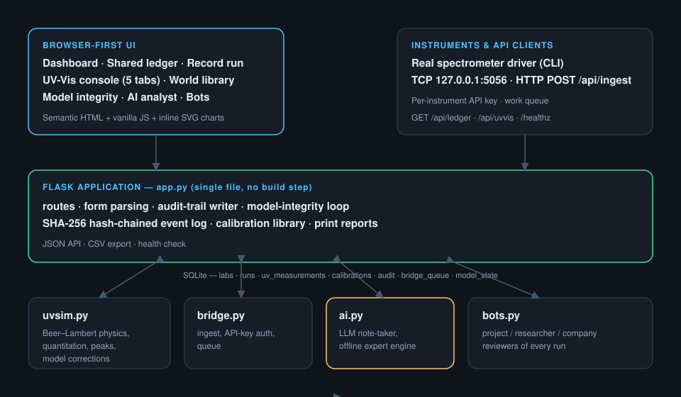

# LabLedger

**A browser-first analytical platform that treats failed experiments as first-class data — and audits itself in public.**

[](https://github.com/enoshiylas23-star/labledger/actions/workflows/ci.yml)
[](LICENSE)
[](https://www.python.org/)
[](https://flask.palletsprojects.com/)

LabLedger is a working prototype that reimagines lab software from the ground up:
a cloud, browser-first system for UV-Vis, HPLC and GC where **every run — success
or failure — can be published to a shared ledger**, so labs stop repeating each
other's mistakes. It is deliberately small: plain Python + Flask + SQLite, no
build step, one optional dependency.

> Its answers to Shimadzu LabSolutions' Windows-only, expensive, single-seat
> world: a five-tab UV-Vis console with a **calibration library**, **live
> quantitation preview** and **active-peak re-analysis**; a per-run
> **SHA-256 hash-chained audit trail** (the 21 CFR Part 11 spirit without a
> server licence); an **instrument bridge** that pulls real spectra over TCP or
> HTTP; and an **AI analyst + review bots** that read the ledger like a colleague.



---

## Why

Most lab software logs successes and quietly buries failures. That means the
same out-of-range results, the same column that always tails, and the same bad
baseline get rediscovered in lab after lab. LabLedger makes the failure mode,
the learning, and the corrective action **citable, searchable and auditable** —
across labs.

## Feature tour

| Area | What you get |
|---|---|
| **Shared ledger** (`/ledger`) | Cross-lab registry of successes *and* failures, full-text search, technique / outcome filters, anonymised publishing. |
| **Record run** (`/runs/new`) | Guided UV-Vis / HPLC / GC form; failures and invalid runs *require* a "what we learned" note; a synthetic trace is generated per run. |
| **Run page** | SVG trace with peak markers, results table, learning note, and an append-only **SHA-256 hash-chained audit trail** with on-page verification. |
| **UV-Vis console** (`/uvvis`) | Five-tab workspace: **Parameters · Baseline setting · System calibration · Quantitation · Active peak pick**. Four modes, five instrument models, virtual physics, a physical-sample path, and an instrument-bridge source. |
| **Quantitation** | Calibration type, weighting (`none` / `1/x` / `1/x²`), zero-intercept option, peak height *or* area, report units (`µM` / `mg/L` / `ppm`), replicates, unknown count — with a **deterministic live preview** before anything is stored. |
| **Calibration library** | Stored working curves with sparklines, equations, standards and one-click *Use in run* / delete. |
| **Active peak re-analysis** | On any saved run, re-analyse at a different peak (absorbances re-scaled by the ε-ratio, curve refit, chart rebuilt) **without ever altering the original PASS/FAIL judgment** — the change is appended to the hash-chained log. |
| **Print report** (`/uvvis/m/<id>/print`) | Standalone printable report: signature lines, full parameters, judgment, calibration, peaks and the chain-tail hash. |
| **Model integrity** (`/uvvis/model`) | The backend scores every measurement against its *own* promised accuracy (±1 nm wavelength, ±2 % recovery, ±2 % RSD, ±5 % kinetic). When it misses, it logs an acknowledged mistake with cause and corrective action, applies the correction and revises the model — auditably, per revision. |
| **World data** (`/world`) | Built-in UV reference library: compounds with λmax, molar absorptivity, bands and CAS; per-compound datasheets and one-click load into the console. |
| **Instrument bridge** (`/instruments`) | Register real instruments; push spectra over TCP (`127.0.0.1:5056`) or HTTP (`POST /api/ingest`), authenticated with a per-instrument key. `driver_example.py` is a working CLI driver. |
| **AI analyst** (`/ai`) | Failure-mode findings with severity, a short verdict, and a question box over the whole ledger. Live LLM when configured, built-in expert engine otherwise (each note is labelled). |
| **Bots** (`/bots`) | Per-project / per-researcher / per-company reviewers that automatically review new matching runs and post scoped notes. |
| **JSON API** | `GET /healthz`, `GET /api/ledger`, `GET /api/uvvis`, `GET /api/uvvis/<id>`, `GET /api/queue`. |

## Quickstart

```bash
git clone https://github.com/enoshiylas23-star/labledger.git
cd labledger
python -m venv .venv
# Windows: .venv\Scripts\activate      macOS/Linux: source .venv/bin/activate
pip install -r requirements.txt

python seed.py     # optional: 8 demo runs across 2 labs, mixed outcomes
python app.py      # http://127.0.0.1:5000  (+ instrument bridge on 127.0.0.1:5056)
```

Requires Python 3.10+ and Flask. The bridge listener only runs while
`app.py` is running in the foreground.

### Configuration

Everything is optional — copy `.env.example` to `.env` and edit:

| Variable | Default | Purpose |
|---|---|---|
| `LABLEDGER_SECRET` | random per boot | Flask session key. |
| `LABLEDGER_DB` | `./labledger.db` | SQLite file location. |
| `LABLEDGER_HOST` / `LABLEDGER_PORT` | `127.0.0.1` / `5000` | Web bind address. |
| `BRIDGE_HOST` / `BRIDGE_PORT` | `127.0.0.1` / `5056` | Instrument bridge listener. |
| `XAI_API_KEY` | – | Enables the live-LLM AI analyst. |
| `LABLEDGER_AI_BASE` / `LABLEDGER_AI_KEY` | – | Any OpenAI-compatible endpoint instead of xAI. |

### Docker

```bash
docker build -t labledger .
docker run --rm -p 5000:5000 -p 5056:5056 -v labledger-data:/data labledger
# open http://127.0.0.1:5000
```

## Development

```bash
python -m unittest discover -s tests -v
```

The suite drives the app through Flask's test client against a throwaway
database (`LABLEDGER_DB` is pointed at a temp file) — no server, no fixtures to
clean up. See [CONTRIBUTING.md](CONTRIBUTING.md) for how to help.

## Project layout

```
app.py              Flask application: routes, schema, audit chain, model loop
uvsim.py            UV-Vis simulation: physics, quantitation, peaks, corrections
bridge.py           Instrument registry, TCP/HTTP ingestion, API-key auth, queue
ai.py               AI analyst: failure analysis, ledger Q&A, offline fallback
bots.py             Per-project / researcher / company review bots
driver_example.py   CLI instrument driver for the bridge
seed.py             Demo data
templates/ static/  UI (semantic HTML, vanilla JS, inline SVG)
tests/              unittest suite (dependency-free)
docs/               Architecture diagram and long-form notes
```

Deep background lives in [ANALYSIS.md](ANALYSIS.md) (competitive teardown),
[DESIGN.md](DESIGN.md) (principles and production architecture) and
[MARKETING.md](MARKETING.md) (market and positioning).

## Status & scope

This is a **prototype**, not production lab software: single-process SQLite,
single workspace, generated data. It is not validated for regulated use. The
audit trail, calibration library and print reports are a serious sketch of what
a credible, better-than-instrument-vendor UX could look like — see
[DESIGN.md](DESIGN.md) §4 for the path to multi-tenant Postgres, OIDC identity
and e-signatures.

## License

[MIT](LICENSE) © 2026 LabLedger contributors.
